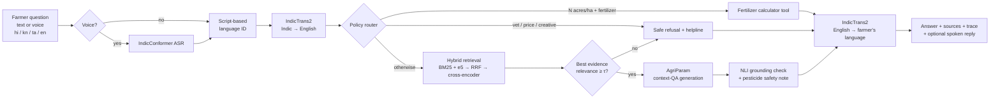
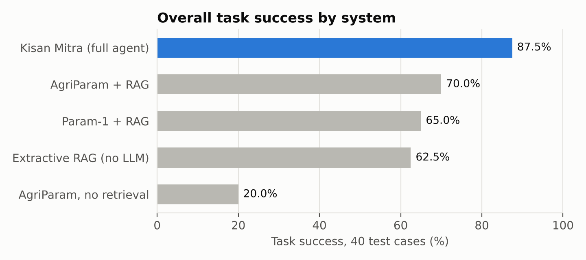

# 🌾 Kisan Mitra — a multilingual, grounded farmer advisory agent

**CS3235 Mini-Project · Option 2: AI Farmer Advisory Assistant (AI4Bharat + BharatGen)**

Kisan Mitra answers crop, irrigation, fertilizer, pest and farmer-scheme questions asked in **Hindi, Kannada, Tamil
or English**, typed or **spoken**. Every answer is grounded in a curated corpus of official advisories
(ICAR, TNAU, PPQS, PIB / Government of India) and shown with its sources. An agent router sends fertilizer-quantity
questions to a deterministic calculator, declines questions it has no evidence for, and adds a pesticide-safety
note when chemicals are involved.

| Component | Model / data |
|---|---|
| Domain LLM | **BharatGen AgriParam** (2.9B, Hindi+English, agriculture-tuned; native `<context> … <user> … <assistant>` RAG format) |
| General LLM baseline | BharatGen Param-1-2.9B-Instruct |
| Translation | **AI4Bharat IndicTrans2** (distilled 200M, Indic↔English) + IndicTransToolkit |
| Speech input | **AI4Bharat IndicConformer** 600M multilingual (CTC + RNNT) |
| Retrieval | BM25 + multilingual-e5-base (dense) → Reciprocal Rank Fusion → MiniLM cross-encoder re-ranker |
| Grounding check | DeBERTa-v3 NLI (MNLI/FEVER/ANLI): is each answer sentence entailed by the evidence? |
| Knowledge base | 17 curated documents (rice, wheat, ragi, maize, cotton, tomato, vermicompost, fertilizer maths, PM-KISAN, PMFBY, PMKSY-PDMC, KCC, Soil Health Card, Kisan Call Centre) |
| Frontend | Gradio (text + microphone, answer in the farmer's language, spoken reply, sources, agent trace) |

## How it works



English is used as the pivot language because the authoritative sources are in English and AgriParam is strongest
there; IndicTrans2 handles both directions. Numbers survive translation (measured as *number preservation*).

## Repository layout

```
kisan-mitra/
├── notebooks/
│   ├── 01_run_all_experiments.ipynb   # Colab: runs every experiment, zips results/
│   └── 02_demo_app.ipynb              # Colab: launches the Gradio app with a public link
├── src/kisan_mitra/
│   ├── pipeline.py      # the agent (language ID → MT → router → retrieval → LLM → checks → MT)
│   ├── router.py        # tool / abstain / RAG routing, safety note
│   ├── tools.py         # fertilizer calculator (N-P-K → urea / SSP / MOP, bags)
│   ├── retriever.py     # BM25, dense (e5), RRF fusion, cross-encoder re-ranking
│   ├── llm.py           # AgriParam, Param-1 and extractive generators
│   ├── translate.py     # IndicTrans2 wrapper (+ CPU stand-ins for tests)
│   ├── asr.py           # IndicConformer wrapper
│   ├── grounding.py     # NLI groundedness checker
│   ├── metrics.py       # key-fact accuracy, tool accuracy, retrieval, abstention, chrF++, WER/CER
│   ├── evaluate.py      # resumable experiment stages + scoring
│   ├── experiment.py    # orchestration (also `python -m kisan_mitra.experiment --dry-run`)
│   └── app.py           # Gradio UI
├── data/
│   ├── corpus/*.md              # curated advisory documents (YAML front matter with source URL)
│   └── eval/testset.jsonl       # 40 test cases (generated by scripts/build_testset.py)
├── configs/default.yaml         # all model names and hyper-parameters
├── tests/test_pipeline.py       # CPU unit + end-to-end tests (no downloads)
├── results/                     # filled by notebook 01
└── reports/                     # project report + failure analysis
```

## Running it

### A. Full experiments on Google Colab (free T4)
1. Upload this whole folder to Google Drive → `My Drive/kisan-mitra`.
2. Create a Hugging Face token (read access) and, while logged in, click **“Agree and access”** on:
   [indictrans2-indic-en-dist-200M](https://huggingface.co/ai4bharat/indictrans2-indic-en-dist-200M),
   [indictrans2-en-indic-dist-200M](https://huggingface.co/ai4bharat/indictrans2-en-indic-dist-200M),
   [indic-conformer-600m-multilingual](https://huggingface.co/ai4bharat/indic-conformer-600m-multilingual).
   (AgriParam and Param-1 are public.)
3. Open `notebooks/01_run_all_experiments.ipynb` in Colab → *Runtime → Change runtime type → T4 GPU* →
   add the token under 🔑 *Secrets* as `HF_TOKEN` → *Run all* (≈60–90 min).
4. Download `kisan_mitra_results.zip` and unzip it into `results/`.

### B. Live demo
Open `notebooks/02_demo_app.ipynb` in Colab → *Run all* → open the `gradio.live` link.

### C. Local, CPU-only checks (no GPU, no downloads)
```bash
pip install -r requirements-dev.txt
pytest -q                                              # 8 tests
python scripts/rescore.py && python scripts/make_figures.py   # re-score saved predictions, rebuild figures (CPU)
PYTHONPATH=src python -m kisan_mitra.experiment --dry-run --results-dir /tmp/dry   # whole pipeline with stand-ins
PYTHONPATH=src python -m kisan_mitra.app --dry-run     # UI with stand-in models (pip install gradio)
```

## Evaluation design

**Test set — 40 cases** (`data/eval/testset.jsonl`), written from the corpus so every gold fact is verifiable
(a unit test checks this):

| Category | n | Languages | What counts as success |
|---|---:|---|---|
| Crop advisory | 20 | en, hi, kn, ta | every key fact (dose, timing, threshold…) present in the answer |
| Farmer schemes | 10 | en, hi, kn, ta | every key fact present |
| Fertilizer quantity (tool) | 5 | en, hi, kn, ta | urea/SSP/MOP within 1 % (agent) or urea within 5 % in free text (baselines) |
| Out-of-scope / unanswerable | 5 | en, hi, kn, ta | the system declines instead of guessing |

**Systems compared** (same retriever, same test set):

| System | Retrieval | LLM | Router / tool / abstain / grounding check |
|---|---|---|---|
| `extractive_rag` | ✓ | none (best-matching sentences) | – |
| `agriparam_closedbook` | – | AgriParam | – |
| `agriparam_rag` | ✓ | AgriParam | – |
| `param1_rag` | ✓ | Param-1 Instruct (general) | – |
| **`kisan_mitra_full`** | ✓ | AgriParam | ✓ |
| `kisan_mitra_full_voice` | ✓ | AgriParam | ✓ (input = IndicConformer transcript of the spoken question) |

**Metrics:** task success (overall and per language), key-fact accuracy and recall, NLI groundedness,
fertilizer-tool accuracy, abstention recall / precision / false-abstain rate (+ a threshold sweep), router accuracy,
retrieval hit@k / MRR (BM25 vs dense vs hybrid vs re-ranked; machine-translated vs human-translated queries),
IndicTrans2 chrF++ per language, number preservation through back-translation, IndicConformer WER/CER (CTC vs RNNT),
latency. A human-evaluation sheet (`results/human_eval_sheet.csv`) is produced for correctness / fluency / safety scoring.

## Results

Evaluation run: Colab Tesla T4, 25.4 min, 40 test cases. Full analysis and failure cases: **[`reports/REPORT.md`](reports/REPORT.md)**.



| System | Task success | QA fact accuracy | Fertilizer tool | Out-of-scope refused | Groundedness | p50 latency |
|---|---:|---:|---:|---:|---:|---:|
| AgriParam, no retrieval | 20.0 % | 26.7 % | 0 % | 0 % | 36.7 % | 2.6 s |
| Extractive RAG (no LLM) | 62.5 % | 83.3 % | 0 % | 0 % | 100 % | 0.9 s |
| Param-1 + RAG | 65.0 % | 73.3 % | 0 % | 80 % | 82.8 % | 7.2 s |
| AgriParam + RAG | 70.0 % | 90.0 % | 20 % | 0 % | 63.3 % | 7.1 s |
| **Kisan Mitra (full agent)** | **87.5 %** | **90.0 %** | **60 %** | **100 %** | 66.1 % | 5.6 s |
| Kisan Mitra, voice input (28 Indic cases) | 78.6 % | 81.8 % | 33.3 % | 100 % | 67.5 % | 5.7 s |

- **Retrieval** lifts AgriParam's fact accuracy from 26.7 % to 90.0 %; hybrid + re-ranking finds a gold document in the top 3 for every answerable question.
- **The agent layer** adds what RAG cannot: correct fertilizer arithmetic (60 % vs 20 %) and refusing out-of-scope questions (5/5 vs 0/5 — plain AgriParam invents onion prices and cricket results).
- **Translation of farm terms is the main bottleneck**: IndicTrans2 rendered ragi as "millet" and early blight (Tamil) as "premature ejaculation"; such errors caused 4 of the agent's 5 failures.
- **Speech**: IndicConformer CTC — WER 14.5 %, CER 4.9 % (Kannada WER is inflated by word-boundary splits); voice input costs 7 points of task success on the Indic subset (85.7 % → 78.6 %).
- IndicTrans2 question chrF++: Hindi 61.0, Kannada 61.8, Tamil 57.1; 98 % of numbers survive back-translation.

## Limitations and responsible use
- Advisory only; the knowledge base is small (17 documents) and partly region-specific (TNAU = Tamil Nadu, wheat = Central India).
  Out-of-coverage questions are declined and referred to the Kisan Call Centre (1800-180-1551) / KVK.
- Scheme facts change; each document records its source date. Re-check before relying on amounts or limits.
- Test speech is synthetic (gTTS), so WER is optimistic; real recordings can be added in `data/eval/audio_user/`.
- Out-of-scope rules (veterinary, price, creative writing) were written by us; the abstention sweep reports the
  threshold-only behaviour separately.

## Acknowledgements
BharatGen (AgriParam, Param-1), AI4Bharat (IndicTrans2, IndicConformer, IndicTransToolkit), TNAU Agritech Portal, ICAR,
ICAR-CICR, Directorate of PPQS, PIB, PM-KISAN, mKisan. Corpus files are paraphrased notes with links to each source.
