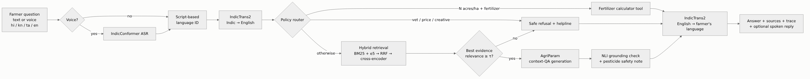
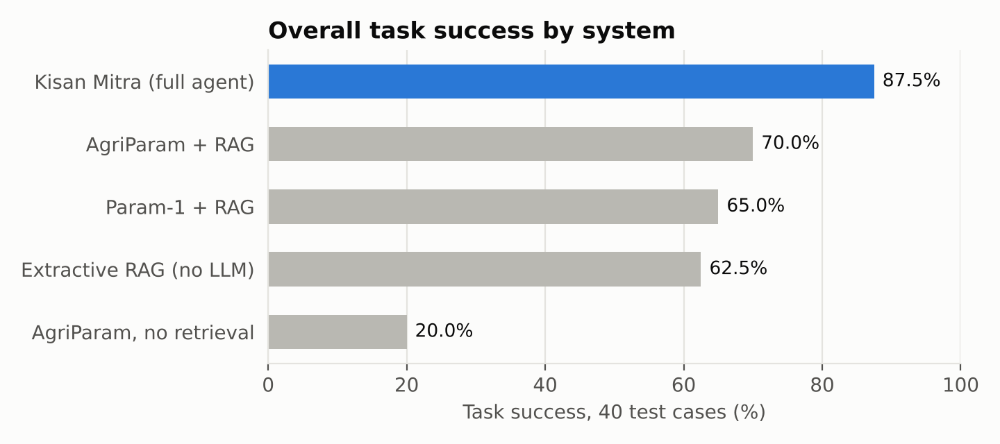
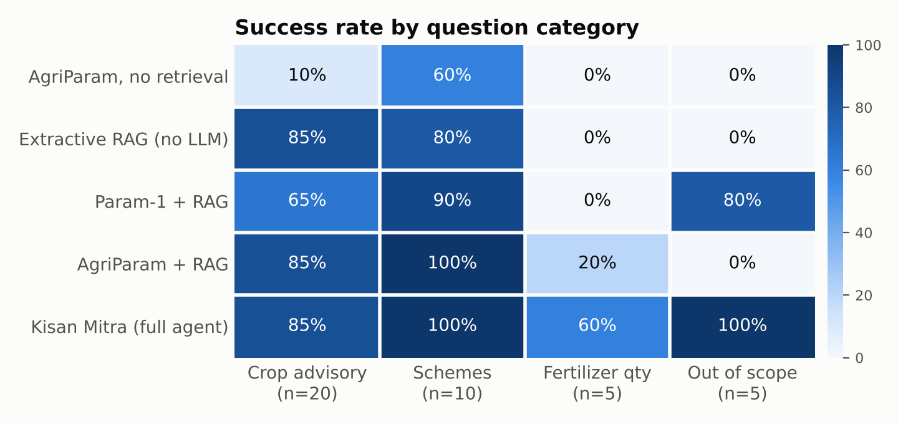
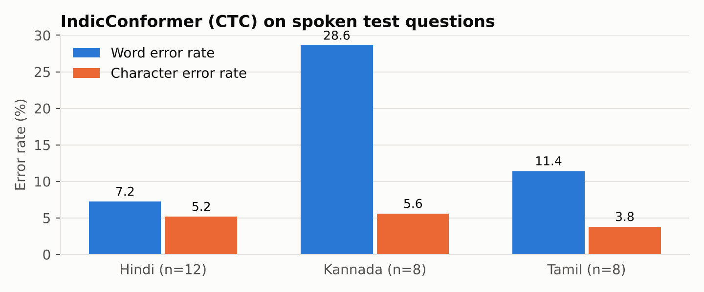
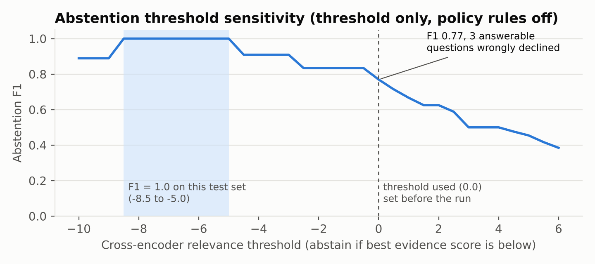

# Kisan Mitra: a multilingual, grounded farmer advisory agent built on BharatGen AgriParam and AI4Bharat models

**CS3235 Mini-Project · Option 2: AI Farmer Advisory Assistant**
Team: _<name 1>, <name 2>, <name 3>, <name 4>_ · Repository: https://github.com/amanchandrah895/kisan-mitra
Evaluation run: 5 November 2026, Google Colab, NVIDIA Tesla T4 (15.6 GB), 25.4 minutes end to end.

---

## Abstract

Kisan Mitra answers farmers' questions about crops, irrigation, fertilizer, pests and government schemes in Hindi,
Kannada, Tamil or English, typed or spoken. The question is translated to English with IndicTrans2 (and transcribed
first with IndicConformer if spoken). An agent router then picks one of three actions. Fertilizer-quantity questions go
to a deterministic calculator. Out-of-scope questions, or questions without supporting evidence, get a safe refusal
with a helpline referral. Everything else is answered by BharatGen AgriParam from passages retrieved out of a curated
corpus of 17 ICAR, TNAU, PPQS and Government of India advisories. An NLI model then checks every answer sentence against
the evidence, and the answer is translated back with its sources.

On a 40-case test set in four languages, the full agent reaches **87.5 % task success**. The next best systems are
AgriParam with the same retrieval (70.0 %), the general Param-1 model with retrieval (65.0 %), and AgriParam alone
(20.0 %). Retrieval accounts for most of the accuracy. The agent layer adds the cases RAG alone cannot handle:
arithmetic (fertilizer quantities, 60 % vs 20 %) and refusing out-of-scope questions (100 % vs 0 %). AgriParam
without retrieval invents onion prices and cricket results.

The dominant remaining error is **machine translation of agricultural terms**. In 9 of 25 answerable Indic questions
a crop, pest or disease name was mistranslated (for example ragi → "millet", early blight → "premature ejaculation").
Those errors caused 4 of the agent's 5 failures. Speech recognition adds little error on synthetic speech (character
error rate 4.9 %). Spoken input lowers task success on the Indic subset from 85.7 % to 78.6 %.

## 1. Problem definition and relevance

Most Indian farmers get advice from extension workers, input dealers or
the Kisan Call Centre (1800-180-1551, 6 am–10 pm), and almost always in an Indian language. Official guidance exists,
but it is spread across ICAR institutes, state agricultural universities and ministry portals, mostly in English and
in technical language.

The goal is an assistant that:

- **Speaks the farmer's language, in text or voice.** It supports Hindi, Kannada, Tamil and English.
- **Answers only from verified sources and shows them.** A wrong pesticide dose or a wrong subsidy figure has real cost.
- **Knows its limits.** It refuses veterinary, market-price and off-topic questions instead of guessing, and refers
  the farmer to KVK or the Kisan Call Centre.
- **Gets the arithmetic right.** It turns an N-P-K recommendation into kilograms and bags of urea, SSP and MOP for the
  farmer's actual area.
- **Runs on free hardware.** A single Colab T4.

## 2. Model and dataset selection

| Role | Choice | Why | Checked before use |
|---|---|---|---|
| Domain LLM | **BharatGen AgriParam** | Agriculture-tuned from Param-1 2.9B. Bilingual English–Hindi. Has a native context-QA prompt (`<context> … <user> … <assistant>`) designed for RAG. | Apache-2.0, public, 2048-token window, F32 weights (~12 GB) loaded as fp16 (~6 GB) on T4 |
| General LLM (baseline) | BharatGen Param-1-2.9B-Instruct | Same base model without agricultural tuning. Isolates the effect of domain tuning. | Public; chat template |
| Translation | AI4Bharat **IndicTrans2** distilled 200M (indic-en and en-indic) + IndicTransToolkit | State-of-the-art open Indic MT covering all 22 scheduled languages; small enough to sit next to the LLM. | MIT, gated (terms accepted); flash-attention disabled on T4; transformers pinned < 5 |
| Speech recognition | AI4Bharat **IndicConformer** 600M multilingual | One model for 22 languages with CTC and RNNT decoders. | MIT, gated; ONNX runtime |
| Dense retrieval | intfloat/multilingual-e5-base | Multilingual, so it can also embed the original-language query (tested as an ablation). | MIT |
| Re-ranker | cross-encoder/ms-marco-MiniLM-L-6-v2 | Precise top-3 ranking. Its score doubles as the evidence-relevance signal for abstention. | Apache-2.0 |
| Grounding check | MoritzLaurer/DeBERTa-v3-base-mnli-fever-anli | Sentence-level entailment of the answer against the evidence. | MIT |

We considered the Document Understanding option (BharatGen Patram) and rejected it. Patram-7B is English-only,
gated, and needs about 16 GB in bf16, which does not fit a free T4.

**Knowledge base.** 17 documents, about 6,200 words. Each is paraphrased from an official source with every number kept
exactly as published (`docs/DATA_CARD.md` lists them all):

- **Crops:** rice nursery, nutrients, water management and SRI (TNAU); wheat for Central India; ragi (TNAU).
- **Pests and diseases:** fall armyworm (PPQS advisory, 2024); pink bollworm (ICAR-CICR); tomato diseases (TNAU).
- **Inputs:** vermicompost (ICAR NEH); fertilizer arithmetic.
- **Schemes and helplines:** PM-KISAN, PMFBY, PMKSY Per-Drop-More-Crop, KCC/interest subvention, Soil Health Card, and
  the Kisan Call Centre.

Where a source was ambiguous we said so rather than guess. For example, the Soil Health Card factsheet gives both a
2-year and a 3-year issue cycle, and an OCR-garbled trap count in the PPQS advisory was left out.

**Test set.** 40 hand-written cases (`data/eval/testset.jsonl`):

- **By language:** 12 English, 12 Hindi, 8 Kannada, 8 Tamil. The Indic questions were written natively, not machine
  translated.
- **By category:** 20 crop advisory, 10 schemes, 5 fertilizer-quantity (tool) and 5 out-of-scope (market price,
  cricket, coconut pest not in the corpus, sick cow, a poem).
- **Labels per case:** a human reference English translation, the gold source documents, and 1–4 *key facts*, each a
  list of accepted surface forms. A unit test checks that every key fact actually appears in its gold documents.

## 3. System design

The architecture diagram is also in the README as Mermaid. The agent (`src/kisan_mitra/pipeline.py`) runs these steps
and records each one, with timings, in a trace that the UI shows:

1. **Language ID.** Script-based: Devanagari → hi, Kannada → kn, Tamil → ta, Latin → en.
2. **Speech (optional).** IndicConformer CTC transcription at 16 kHz.
3. **Translation to English.** IndicTrans2 with beam 5. English is the pivot language because the sources and
   AgriParam's strongest language are English.
4. **Policy router.** Applied before retrieval:
   - Animal + illness words → veterinary referral.
   - "price / mandi rate" → no-live-data referral.
   - Creative-writing requests → out of scope.
   - A fertilizer word + an explicit area ("3 acres", "2 hectares") + a known crop → **fertilizer tool**.
5. **Hybrid retrieval.** BM25 and e5 each return 10 candidates. They are fused by Reciprocal Rank Fusion (k = 60) and
   re-ranked by the cross-encoder; the top 3 chunks go to the model. Chunks are `##` sections split into 160-word
   windows.
6. **Relevance router.** If the best cross-encoder score is below τ = 0.0, the agent abstains. τ was fixed before the
   run.
7. **Generation.** AgriParam with greedy decoding, at most 160 new tokens, repetition penalty 1.1, and at most 1,100
   tokens of context.
8. **Guardrails.**
   - NLI grounding check: if under 50 % of answer sentences are entailed by the evidence, a "please confirm with KVK"
     caveat is appended.
   - A pesticide-safety note is added when chemicals appear in the question or answer.
9. **Back-translation and citations.** The answer is sentence-split, translated with IndicTrans2, and returned with
   source titles and links.

**Fertilizer tool** (`tools.py`). It holds N-P2O5-K2O recommendations from the corpus for 9 crop situations and computes:

- urea = N ÷ 0.46
- single super phosphate = P2O5 ÷ 0.16
- muriate of potash = K2O ÷ 0.60

It scales by area (1 acre = 0.4047 ha) and gives 45 kg / 50 kg bag counts. The arithmetic reproduces the published
wheat table: 120 kg N → 260 kg urea, 60 kg P2O5 → 375 kg SSP, 30 kg K2O → 50 kg MOP.

**Frontend** (`app.py`, Gradio). It has:

- a text box and a microphone/upload input, with automatic or manual language choice;
- the answer in the farmer's language plus the internal English answer;
- an optional spoken reply (gTTS);
- sources with links, and a collapsible agent trace showing each step and the grounding score.

`notebooks/02_demo_app.ipynb` serves it with a public link from Colab.

## 4. Experimental setup

Systems compared. All use the same corpus, retriever and test set.

| System | Retrieval | Generator | Router / tool / abstention / grounding caveat |
|---|---|---|---|
| `agriparam_closedbook` | – | AgriParam | – |
| `extractive_rag` | ✓ | none (2 best-matching evidence sentences) | – |
| `param1_rag` | ✓ | Param-1 Instruct | – |
| `agriparam_rag` | ✓ | AgriParam | – |
| **`kisan_mitra_full`** | ✓ | AgriParam | ✓ |
| `kisan_mitra_full_voice` | ✓ | AgriParam | ✓ (input is the ASR transcript of gTTS audio, 28 Indic cases) |

**Success criteria per case:**

- **Advisory and scheme questions:** every key fact present and no refusal.
- **Tool questions:** urea, SSP and MOP within 1 % for the agent. Systems without the tool pass if the right urea
  quantity (±5 %) appears anywhere in their text.
- **Out-of-scope questions:** the system declines.

**Other metrics:** key-fact recall, NLI groundedness (share of answer sentences entailed, threshold 0.5), routing
accuracy, retrieval hit@k and MRR, IndicTrans2 chrF++ against the human reference translation, number preservation
through back-translation, and IndicConformer WER and CER.

**Runtime notes.**

- Both Param-family models ran in fp16; logits were finite, so no fp32 fallback was needed.
- `generate(use_cache=True)` failed in their custom code under transformers 4.56.2, so the pipeline fell back to
  `use_cache=False` automatically, as both model cards do. This roughly doubles generation time but does not change
  outputs.
- Every stage is resumable, and the run finished with zero errors.

**One scoring fix after the run.** Reading the outputs showed that the refusal detector missed phrasings such as "I do
not have the information" and "There is no direct information". This only affected Param-1, which phrases its
refusals that way. We widened the pattern and re-scored all saved predictions on CPU (`scripts/rescore.py`; the
originals are kept as `results/*_before_rescore.csv`). This changed 5 Param-1 predictions to "refused". Param-1's
success rose from 55.0 % to 65.0 %, and no other system changed.

## 5. Results

### 5.1 Main results

| System | Task success | QA all-facts acc. | QA fact recall | Groundedness | Tool qty acc. | OOD refusal | False refusals | Route acc. | p50 latency |
|---|---:|---:|---:|---:|---:|---:|---:|---:|---:|
| AgriParam, no retrieval | 20.0 % | 26.7 % | 37.8 % | 36.7 % | 0 % | 0 % | 0 % | – | 2.6 s |
| Extractive RAG (no LLM) | 62.5 % | 83.3 % | 86.7 % | 100 %* | 0 % | 0 % | 0 % | – | 0.9 s |
| Param-1 + RAG | 65.0 % | 73.3 % | 78.3 % | 82.8 % | 0 % | 80 % | 3.3 % | – | 7.2 s |
| AgriParam + RAG | 70.0 % | 90.0 % | 91.7 % | 63.3 % | 20 % | 0 % | 0 % | – | 7.1 s |
| **Kisan Mitra (full agent)** | **87.5 %** | **90.0 %** | **91.7 %** | 66.1 % | **60 %** | **100 %** | 3.3 % | 92.5 % | 5.6 s |
| Kisan Mitra, voice input (28 Indic cases) | 78.6 % | 81.8 % | 85.6 % | 67.5 % | 33.3 % | 100 % | 4.5 % | 89.3 % | 5.7 s |

Notes on the columns:

- **QA columns** cover the 30 advisory and scheme questions.
- **\*** Extractive answers copy the evidence verbatim, so their groundedness is 100 % by construction.
- **Latency** is end-to-end per question on a T4, including both translations. Systems ran one after another in the
  same session, so identical answer sentences reused cached translations; generation (about 5 s) dominates.

**Success by language:**

| System | English (12) | Hindi (12) | Kannada (8) | Tamil (8) |
|---|---:|---:|---:|---:|
| AgriParam, no retrieval | 25.0 % | 25.0 % | 0.0 % | 25.0 % |
| Extractive RAG | 41.7 % | 83.3 % | 62.5 % | 62.5 % |
| Param-1 + RAG | 66.7 % | 66.7 % | 62.5 % | 62.5 % |
| AgriParam + RAG | 66.7 % | 83.3 % | 62.5 % | 62.5 % |
| **Kisan Mitra (full)** | **91.7 %** | **100 %** | **75.0 %** | **75.0 %** |

**Key findings:**

1. **Retrieval is the biggest single gain.** AgriParam goes from 26.7 % to 90.0 % fact accuracy on advisory and
   scheme questions when given the evidence. Without it, it gives confident but wrong numbers: 40–50 kg/ha hybrid
   rice seed (correct is 20), "7 AM–10 PM" for the call centre (correct is 6 AM), "up to 90 %" drip subsidy (correct
   is 55 %).
2. **Domain tuning helps accuracy but not caution.** With identical evidence, AgriParam beats general Param-1 on facts
   (90.0 % vs 73.3 %). Param-1 is more grounded (82.8 % vs 63.3 % entailed sentences) and refuses 4 of 5 out-of-scope
   questions on its own. AgriParam never refuses. It answers "The onion price in Nashik mandi next week is Rs. 30/kg"
   and "Maharashtra won the Cricket World Cup 2011". A domain model therefore needs an external abstention mechanism,
   which is what the router provides.
3. **The agent layer covers what RAG cannot.** Its 17.5-point gain over AgriParam + RAG comes entirely from:
   - **Tool questions** (60 % vs 20 %). LLM arithmetic was consistently wrong: "900 kg of urea" for 2 ha of wheat
     (correct ≈ 522), "3 acres would be approximately 8.194 hectares", "260 kg/ha × 0.4047".
   - **Out-of-scope refusals** (5/5 vs 0/5).

   The cost is one false refusal out of 30 answerable questions.
4. **An extractive baseline is strong.** With no LLM at all, extractive RAG matches AgriParam + RAG on crop advisory
   (85 %) at a tenth of the latency. The LLM's value is in fluent, focused answers, scheme questions (100 % vs 80 %) and
   multi-part facts, not in finding the answer.

### 5.2 Retrieval

Results on the 35 answerable cases, with the gold document within the top k:

| Mode | Query | hit@1 | hit@3 | MRR |
|---|---|---:|---:|---:|
| BM25 | MT English | 0.914 | 0.971 | 0.938 |
| Dense (e5) | MT English | 0.943 | 1.000 | 0.967 |
| Dense (e5) | original Indic text | 0.857 | 0.971 | 0.910 |
| Hybrid (RRF) | MT English | 0.943 | 0.971 | 0.964 |
| **Hybrid + re-rank** | **MT English** | **0.971** | **1.000** | **0.986** |
| Hybrid + re-rank | human reference English | 0.943 | 1.000 | 0.967 |

- **Retrieval is robust.** The full stack finds a gold document in the top 3 for every answerable question, even when
  the translation garbles the key term: the remaining words ("pheromone traps per hectare… cotton") still identify
  the document.
- **Translating first helps the dense retriever.** On the original Indic text it drops to 0.857 hit@1; the English
  pivot is worth it.
- **Re-ranking fixes the remaining top-1 errors.**
- **Retrieval is close to ceiling.** On this small corpus, its errors are not what limits the system.

### 5.3 Translation (IndicTrans2, questions → English)

chrF++ against our reference translations: Hindi 61.0, Kannada 61.8, Tamil 57.1, overall 60.1. Numbers survive the
answer's back-translation well: 98 % of the numbers in the full agent's English answers appear in the Hindi, Kannada or
Tamil output. Section 6.1 shows that the average hides the real problem, which is domain terminology.

### 5.4 Speech (IndicConformer on synthetic speech)

CTC decoding gives WER 14.5 % and CER 4.9 % over 28 questions (RNNT: 15.6 % / 5.1 %). Kannada WER is 28.6 % while its
CER is only 5.6 %. The errors are almost all word-boundary errors in an agglutinative script, which WER over-penalises.
Examples:

- *ಹಳದಿ ಅಂಟು* → *ಹಳದಿಯಂಟು* (two words heard as one)
- *ಪಿಎಂ* → *ಪಿ ಎಂ* (one word split in two)
- *ತೆಂಗಿನ ಮರದಲ್ಲಿ* → *ತೆಂಗಿನಾಮ್ರದಲ್ಲಿ* (two words merged)

In Hindi, "2011" was transcribed as the spoken words *दो हज़ार ग्यारह*: correct, but scored as errors.

End to end on the same 28 Indic questions, voice input reaches **78.6 %** task success against **85.7 %** for typed
input. That is two extra failures (Section 6.4).

### 5.5 Abstention threshold

With τ = 0, chosen before the run, the threshold alone would refuse all 5 out-of-scope questions but also 3 answerable
ones. Policy rules routed three of the out-of-scope questions earlier (price, sick cow, poem), and the tool router
caught one of the answerable ones (tool02). In the actual run, 2 answerable questions were wrongly refused: ta04 and tool03, both
after a bad translation.

Every out-of-scope question scored below −8.9 and every answerable question above −5. So any τ between −8.5 and −5.0
would have separated them perfectly on this set. That was tuned on test data, so we report τ = 0 as the result and the
sweep as evidence that τ ≈ −5 should be calibrated on a separate development set.

### 5.6 Does the grounding caveat work?

In the full agent, 8 of 29 generated answers to advisory and scheme questions were flagged with the "please confirm"
caveat. **Both wrong answers were flagged (recall 2/2)**, but so were 6 correct ones (precision 25 %).

- **Typical true flag:** "the seed rate is 2 kg per hectare" (the source says 20 kg).
- **Typical false alarm:** a correct answer worded far from the evidence, such as the Kannada pink-bollworm answer.

The caveat is a useful cautious signal but too noisy to block answers on.

## 6. Failure analysis

The full agent failed 5 of 40 cases (en01, kn01, ta04, tool03, tool04). Across all systems the failures fall into these
categories:

### 6.1 Agricultural terms mistranslated (the largest error source)

In 9 of 25 answerable Indic questions, IndicTrans2 mistranslated the crop, pest or disease name:

| Case | Source term | MT output | Correct | Effect on the full agent |
|---|---|---|---|---|
| ta04 | முன்பருவ கருகல் (early blight) | "premature ejaculation" | early blight | evidence scored −4.9 → **wrongly refused** |
| tool03 | ರಾಗಿ (ragi) | "millet" | ragi / finger millet | tool could not identify the crop → **wrongly refused** |
| tool04 | வீரிய ஒட்டு நெல் (hybrid paddy) | "millets" | hybrid rice | tool skipped; the LLM answered "400 kg urea" for millets → **wrong** |
| kn01 | ರಾಗಿ | "millet" | ragi | the LLM mixed up seed rate and fertilizer dose → **wrong** |
| kn02 | ರಾಗಿ | "millet" | ragi | still correct (retrieval found the ragi document) |
| kn03 | ಗುಲಾಬಿ ಕಾಯಿಕೊರಕ (pink bollworm) | "rose husk" | pink bollworm | correct number, but "rose husk" leaked into the answer |
| kn04 | ಎಲೆ ಮುರುಟು (leaf curl) | "leaf rot" | leaf curl | correct |
| hi05 | गुलाबी सुंडी (pink bollworm) | "pink sundi" | pink bollworm | correct |
| hi06 | पत्ती मोड़क (leaf curl) | "leaf-worm disease" | leaf curl | correct fact, but "leaf-worm disease" leaked into the answer |

These errors caused **4 of the full agent's 5 failures**. The other 5 were absorbed by robust retrieval, but the wrong
term then leaked into the answer shown to the farmer. A general-domain MT model does not know regional agricultural
vocabulary.

**Fix (future work):** a glossary of crop, pest and disease names applied before translation, mapping, for example,
ರಾಗಿ to "ragi (finger millet)". IndicTrans2 can carry such tagged spans through translation.

### 6.2 The generator reads the wrong number from correct evidence

- **en01.** The evidence says "the seed rate is 20 kg per hectare" and "1 kg seed per cent of nursery". AgriParam
  produced "**2 kg** per hectare". The grounding check flagged it.
- **kn01.** Asked for the fertilizer dose of irrigated ragi, it answered with the rainfed *seed* rate (15–20 kg/ha)
  from the same document.
- **hi03 (voice run).** It answered 120 : **70 : 35** instead of 120 : 60 : 30, mixing in the durum-wheat row
  (140 : 70 : 35) of the same table.

Small models (2.9B) are weak at choosing the right row of a table or list in the context. Remedies: give tables to the
model as one row per chunk, raise the re-ranker's granularity, or extract the number with a span model.

### 6.3 Hallucination without evidence (baselines)

AgriParam closed-book got 2 of 20 crop questions right and invented plausible numbers for the rest:

- "1.3–1.5 kg" of seed for a hectare of paddy, instead of a 20-cent nursery;
- PM-KISAN amounts that "vary based on household size";
- "Maruca vitrata" as the vector of tomato leaf curl (the vector is whitefly).

With retrieval but no router, AgriParam answered all 5 out-of-scope questions with invented facts.

### 6.4 Speech-specific failures (voice run, 2 extra failures)

- **hi04.** The transcript was close, but MT produced "parasitic keeps", so the answer omitted "Trichogramma".
- **kn01.** The transcript lost *ರಾಗಿ*; MT returned "an irrigated crop" with no crop at all, and the answer gave
  farmyard-manure quantities.

Number verbalisation ("2011" → words) did not break any downstream answer.

### 6.5 Metric and test-set artefacts (not system errors)

- **Strict key facts.** Strict matching can under-credit a correct answer: Param-1's "Rs 6,000 per year" (hi02) failed
  because it omitted the Rs 2,000 instalment.
- **Answers that include the gold fact.** Some extractive answers contain the gold fact but also an unrelated
  sentence, for example early blight's 24–29 °C next to wilt conditions.
- **Undercounted refusals.** The refusal detector initially missed polite refusals (Section 4).
- **Human judgement still needed.** `results/human_eval_sheet.csv` holds the full agent's, AgriParam-RAG's and
  Param-1's answers with blank columns for correctness, fluency in the local language and safety.

## 7. Limitations

- **Small, regional corpus.** 17 documents: TNAU guidance is for Tamil Nadu and the wheat guidance is for Central
  India. Questions outside it are refused, which is safe but limits usefulness.
- **Small test set written by the authors.** 40 cases cannot resolve differences of a few points. Each case is worth
  2.5 %, or 12.5 % for a language with 8 cases.
- **Optimistic speech results.** The audio is clean synthetic speech; real field recordings would have noise, dialect
  and code-mixing. Real recordings placed in `data/eval/audio_user/` are evaluated automatically.
- **Hand-written policy rules.** The veterinary, price and creative-writing rules were written by us. The
  threshold-only sweep in Section 5.5 shows the behaviour without them.
- **Scheme facts change.** Each document records its source date (2019–2025).

## 8. Conclusion and future work

A practical Indian-language advisory assistant can run on a free GPU by combining a 2.9B domain LLM with a strong MT
model, hybrid retrieval and a thin agent layer. Retrieval provides accuracy. Tools and abstention provide arithmetic
and safety, which even a domain-tuned LLM lacks. The main open problem is **domain-aware translation**.

Next steps, in priority order:

1. A crop, pest and disease glossary with constrained translation.
2. Calibrating τ on a separate development set (the sweep suggests about −5).
3. Testing with recordings from real farmers.
4. Expanding the corpus with state-wise packages of practice and live mandi and weather data (Agmarknet, IMD) as
   additional tools.
5. Direct Hindi generation with AgriParam (it is bilingual) to avoid two translation hops for Hindi users.

## 9. Reproducibility

- **Run everything:** `notebooks/01_run_all_experiments.ipynb` on a Colab T4, about 25 minutes plus downloads.
- **Outputs:** all raw predictions (`results/predictions/*.jsonl`, each with its full agent trace), per-case scores,
  ablations and the run configuration (`results/run_info.json`) are in the repository.
- **Without a GPU:** `python scripts/rescore.py` re-scores the predictions and `python scripts/make_figures.py`
  rebuilds the figures.
- **Tests:** `pytest -q` runs 8 CPU tests.

**Software versions:** torch 2.11.0+cu130, transformers 4.56.2, sentence-transformers 5.7.0, onnxruntime 1.31.1.

## Appendix A: per-case outcome of the full agent

Generated from `results/per_case_scores.csv`.

| id | lang | category | route | success | note |
|---|---|---|---|:-:|---|
| en01 | en | advisory | rag | ✗ | read "2 kg" instead of 20 kg (caveat added) |
| en02 | en | advisory | rag | ✓ |  |
| en03 | en | advisory | rag | ✓ |  |
| en04 | en | advisory | rag | ✓ |  |
| en05 | en | scheme | rag | ✓ |  |
| en06 | en | scheme | rag | ✓ | correct; caveat added |
| en07 | en | advisory | rag | ✓ |  |
| en08 | en | advisory | rag | ✓ |  |
| hi01 | hi | advisory | rag | ✓ |  |
| hi02 | hi | scheme | rag | ✓ |  |
| hi03 | hi | advisory | rag | ✓ |  |
| hi04 | hi | advisory | rag | ✓ |  |
| hi05 | hi | advisory | rag | ✓ | correct; caveat added |
| hi06 | hi | advisory | rag | ✓ | correct; caveat added |
| hi07 | hi | scheme | rag | ✓ |  |
| hi08 | hi | scheme | rag | ✓ |  |
| hi09 | hi | scheme | rag | ✓ |  |
| hi10 | hi | scheme | rag | ✓ | correct; caveat added |
| kn01 | kn | advisory | rag | ✗ | MT ragi→"millet"; wrong section used |
| kn02 | kn | advisory | rag | ✓ |  |
| kn03 | kn | advisory | rag | ✓ | correct; caveat added |
| kn04 | kn | advisory | rag | ✓ |  |
| kn05 | kn | scheme | rag | ✓ | correct; caveat added |
| kn06 | kn | advisory | rag | ✓ |  |
| ta01 | ta | advisory | rag | ✓ |  |
| ta02 | ta | advisory | rag | ✓ |  |
| ta03 | ta | advisory | rag | ✓ |  |
| ta04 | ta | advisory | abstain | ✗ | MT early blight→"premature ejaculation"; refused |
| ta05 | ta | scheme | rag | ✓ |  |
| ta06 | ta | scheme | rag | ✓ |  |
| tool01 | en | tool | tool | ✓ | urea 522 kg |
| tool02 | hi | tool | tool | ✓ | urea 660 kg |
| tool03 | kn | tool | abstain | ✗ | MT ragi→"millet"; crop unknown, refused |
| tool04 | ta | tool | rag | ✗ | MT hybrid paddy→"millets"; LLM arithmetic wrong |
| tool05 | en | tool | tool | ✓ | urea 352 kg |
| ood01 | en | ood | abstain | ✓ | refused (market_price) |
| ood02 | hi | ood | abstain | ✓ | refused (low_relevance) |
| ood03 | kn | ood | abstain | ✓ | refused (low_relevance) |
| ood04 | ta | ood | abstain | ✓ | refused (veterinary) |
| ood05 | en | ood | abstain | ✓ | refused (not_agri) |
